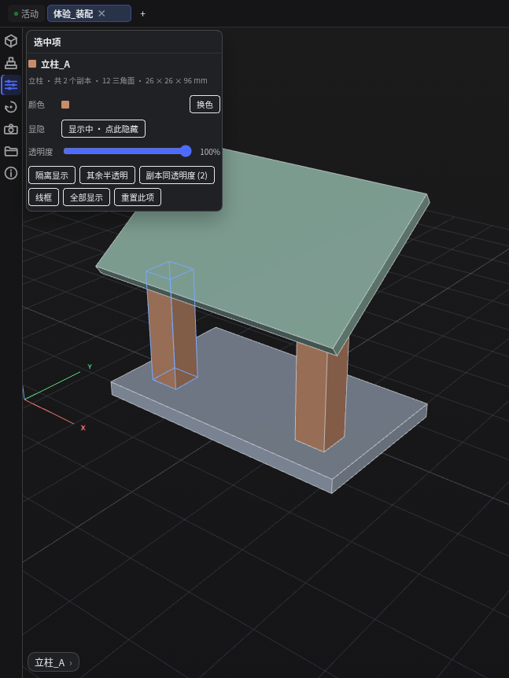
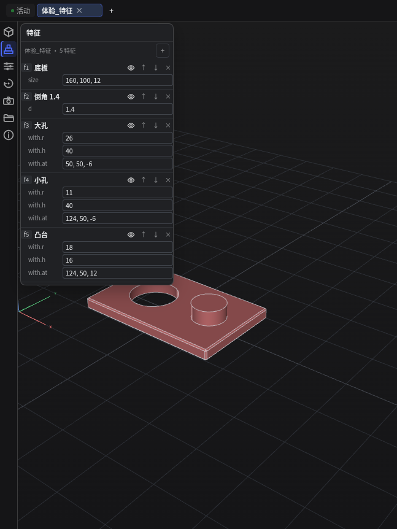
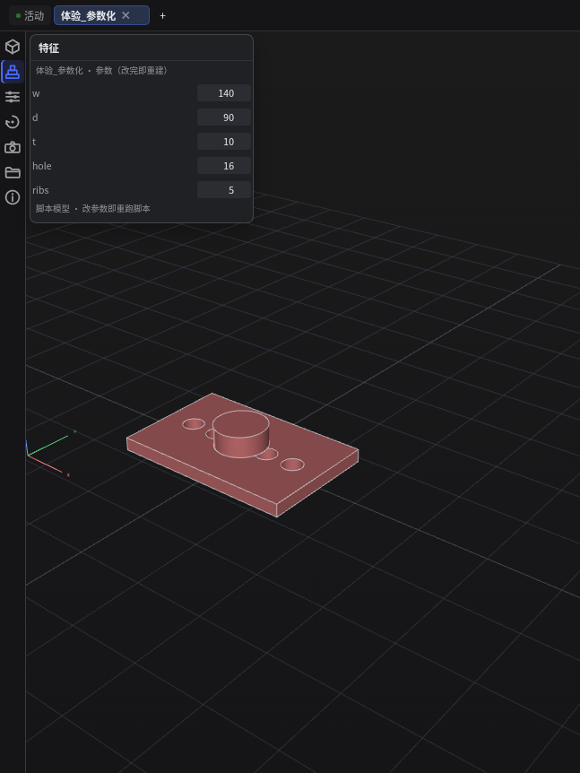
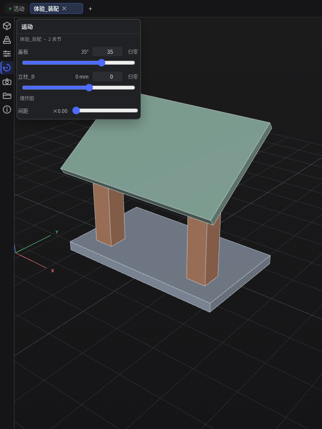
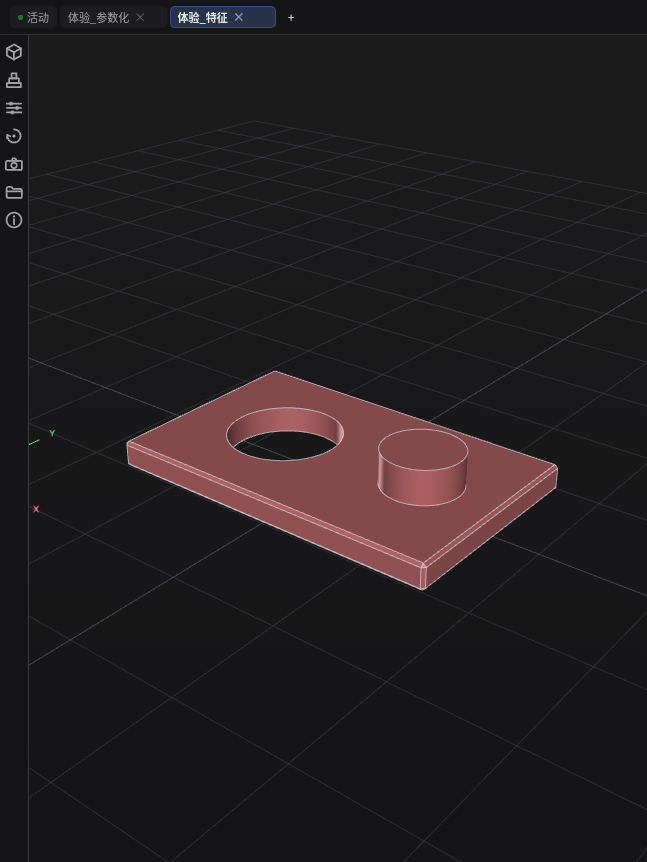

# dsh-cad-studio

DeepSeek Harness 的 CAD 插件：**把 FreeCAD 桥接成给 AI 用的工具**，并在 Web 右栏提供一个只读+轻交互的 3D 面板。


- Host 侧（`index.js`）：19 个工具 + `/cad-studio/*` HTTP 路由 + `freecadcmd` 子进程桥
- 客户端侧（`client.js`）：右栏页签「CAD 工作室」，three.js 视口 + 图标条浮层（零件 / 特征 / 选中项 / 运动 / 视图 / 模型 / 信息）
- 数据：`<modelsDir>/<名字>.json` 存模型工程（脚本或声明式特征 + 参数 + 20 条历史）；场景网格落 `$TMPDIR/dsh-cad-studio/{state.json,scenes/*.json}`

## 能力

| 领域 | 做什么 |
|---|---|
| 建模 | `cad_studio_feature` 声明式特征（box/cylinder/sphere/cone/torus/extrude/revolve/fuse/cut/common/fillet/chamfer/shell/pattern/translate/rotate/mirror）；`cad_studio_run` 跑任意 FreeCAD Python |
| 工程文件 | `cad_studio_doc` 存 `script` 或 `features` 两种模型；`cad_studio_features` 改一条特征→整表重算（0.2–0.6 s），失败整表回滚 |
| 装配 | `cad_studio_assembly` 读 manifest，`App::Link` 语义的实例位姿；零件是 STEP 文件级引用（改零件重开即跟随；没有文件监视，重跑才刷新）；**同名 `assembly` 原地重建**（保关节/mate/外观），要再开一个副本用 `assembly:'new'`；`follow:true` 会让它盯住部件文件、变了自动重建（默认关：自动把正在看的场景换掉更糟）；`measure:true` 回每实例体积/包围盒，`interference:true` 回真正重叠的实例对 |
| 运动 | `cad_studio_joint`（revolute/linear）+ `cad_studio_drive` + `cad_studio_explode`，面板拖滑杆看运动 |
| 出图 | `cad_studio_drawing` HLR → SVG（主/俯/左/等轴）；`cad_studio_sheet` 正式图纸（图框 + 标题栏 + 三视图 + 尺寸，A4/A3/A2，可出 DXF） |
| 装配 | `cad_studio_assembly` 多零件实例、`cad_studio_joint` 关节、`cad_studio_mate` 约束（同心/贴合/距离）、`cad_studio_drive` 驱动、`cad_studio_explode` 爆炸图 |
| 依赖 | `cad_studio_deps` 列出模型的来源 STEP（谁在用、还在不在、**哪个件比装配新**；面板「来源文件」每 5 秒自检一次，变了的件标 `changed`，旁边有「重建」按钮与「自动跟随」开关，后者等价于 `cad_studio_deps {action:'follow'}`），`relink` 换路径后原地重建、`rebuild` 给 0.24 之前建的老装配补一次源文件清单、`delete` 忘掉一条记录、`prune` 一次清掉所有场景已删的空壳记录；面板「信息」里能直接填新路径 |
| 外观 | 面板里改的颜色/显隐/透明度/线框按模型保存（`POST /cad-studio/appearance`），刷新和重启后仍在 |
| 其它 | `cad_studio_open`（STEP/STL/BREP/IGES 进来看）、`cad_studio_export`、`cad_studio_measure`、`cad_studio_env`；`cad_studio_doc {action:"create", from:"…/x.step"}` 把已有 STEP 变成可编辑模型文档 |
| 模型清单 | `cad_studio_scene`（`action: list / delete / rename / prune`，`ids:[…]` 一次删多行）——面板里那条列表就是它；0 体积 0 三角的幽灵行会被标 `stale`，`prune` 一次清掉 |
| 模型改名 / 复制 | `cad_studio_doc {action:"rename", name, to}` 与 `{action:"duplicate", name, to}`：改名会同步列表里的标题与 `docKey`，复制会得到一条独立的新场景（副本不继承运行历史与撤销栈）；两者都可 `cad_studio_undo` 回退 |
| 几何自检 | `cad_studio_check {source}` 在导出/打印前问一次：是否有效实体、外壳是否闭合、每个实体体积多少，返回中文问题清单（零体积 / 外壳未闭合 / 几何无效 / 没有实体） |
| 拔模挤出 | `{kind:"extrude", sketch:"S1", h:20, draft:3}` 按 3° 拔模：截面按 `h*tan(3°)` 偏移后 loft 成体，正角度内收、负角度外放 |
| 展开图 | `cad_studio_unfold {source, target:"…/net.dxf"}` 把板类零件按共享边摊平成下料图（面片等距铺开，面积与模型一致；孔各自成环；圆柱/圆角等曲面报 `curvedSkipped` 而不是瞎编），可写 DXF 或 SVG |
| 改动记录 | `cad_studio_changes {model}` 看谁改了什么（会话 / 面板 / 外部）；每次写都会涨 `rev` 并留一行，面板「信息」里也能看到。别的工具的结果里会顺带一句「自你上次之后，面板改了 N 处」。0.29.0 起「下一次动手」不再等于「先动手再知情」：人改过之后，会话的**写操作会被拒绝一次**（`needsReview`，不给文件动一下），看清了带 `ifRev=<rev>` 重发才算覆盖（或 `force:true` 硬盖并回报 `overwrote`）|
| 打印网格 | `cad_studio_mesh {source, target:"…/x.stl"}` 三角化 + 去重合并点/面、修形变、统一法向，可选 `fillHoles`、`targetSize`（减面）；回报修复前后的 facets/points，避免「导出成功但网格是碎的」 |
| 旋转体与凹槽 | `revolve` 的 `axis` 取草图平面内的轴（`"Y"` 或 `[0,1,0]`）才是实体；垂直轴（XY 草图的 Z）只会扫出零厚度圆环，插件会直接报错。凹槽＝`{kind:"cut", with:{kind:"revolve", …}}`，不需要单独 op |
| 面板改草图 | 特征抽屉里点「草图 N」展开：数值约束是可编辑输入框（`distance*`/`radius`/`angle` 按度），改完立刻重解并重建；解不出来就回滚并报错 |
| 撤销跨重启 | 文档级撤销栈（建/删/改名）写进 `<数据目录>/journal.json`，重启后仍可撤销；装配与视图的撤销只在本次会话内有效 |
| 草图约束 | `equal`（等长）、`symmetric`（三点对称，需 `c` 点）、`angle`（**单位是度**，内部转弧度并在求解后重测）；`distance` 是两点距离、`distance_x/y` 是该点的绝对坐标 |
| 草图 + 放样/扫掠 | 草图存在文档里（`cad_studio_doc {action:"create", kind:"features", sketches:{S1:{geometry:[…],constraints:[…]}}, features:[{kind:"extrude",sketch:"S1",h:10}]}`）；`loft` 用 `sections:[{sketch:"S1"},{sketch:"S2",at:[0,0,40]}]`，`sweep` 用 `path:[[x,y,z],…]`。改草图会重建（草图进了缓存哈希，不会命中旧 BREP） |
| 特征 → STEP | `cad_studio_export {model:"名字", target:"…/x.step"}` 或 `cad_studio_doc {action:"show", name, export:"…/x.step"}`；特征列表是源，STEP 是产物，不用自己复刻发射器 |
| 旧 dsh-cad 文档 | `cad_studio_legacy`（`action: list / show`）只读列出 `/app/.dsh-cad` 的文档、op 数与体数 |
| 自检/安装 | `cad_studio_setup`：报告 freecadcmd 是否可用、版本、包管理器与可执行命令；`action=install` 直接装 |
| 面板 | 多页签（上限 5，各自记住相机与配色）、点选联动、色块换色、显隐、透明度、线框、隔离、标准视图、网格/轮廓/光影开关 |

## 安装

需要本机有 `freecadcmd`（FreeCAD ≥ 0.20）。装插件不等于装 FreeCAD——它是外部程序，200 MB 上下，不随 npm 包分发。Linux / macOS / Windows 都一样：先有 FreeCAD，再让插件找到它。

装法二选一：

1. **让面板装**：打开右栏「CAD 工作室」→ 信息（i）→ 看到黄框点「自动安装 FreeCAD」。后端 `cad_studio_setup` 按平台识别包管理器并执行：Linux 用 apt / dnf / pacman（apt 需要 root）、macOS 用 brew、Windows 用 winget 或 choco（winget 装在用户态，不需要管理员）。
2. **自己装**：下面的命令装完后，插件配置里 `freecadPath` 留空即可——它自己按平台去找（Linux `/usr/bin`、`/usr/local/bin`、`/opt/freecad/bin`、`/snap/bin`、`/usr/lib/freecad*/bin`；macOS 的 `FreeCAD.app/Contents/MacOS/FreeCADCmd` 与 Homebrew；Windows 的 `C:\Program Files\FreeCAD*\bin\freecadcmd.exe`、`%LOCALAPPDATA%\Programs\FreeCAD\bin`、PATH）。

```bash
# Linux
apt install freecad        # Debian/Ubuntu；Fedora: dnf install freecad；Arch: pacman -S freecad
# macOS
brew install --cask freecad
```
```powershell
# Windows（任选其一；装完不用配路径，插件会扫 C:\Program Files\FreeCAD*\bin）
winget install --id FreeCAD.FreeCAD -e --accept-package-agreements --accept-source-agreements
choco install freecad -y
```

```bash
# 从 npm 装（推荐）
dsh plugin --profile web add dsh-cad-studio

# 或从源码目录装
dsh plugin --profile web add /path/to/dsh-cad-studio
# 装完重启 dsh 使 host 侧工具挂载；client 侧刷新页面即可
```

npm 包：<https://www.npmjs.com/package/dsh-cad-studio>（`dsh plugin` / DSH 插件市场按包名解析，发布到 npm 即可被装到）。

配置项（cordis 配置）：

| 键 | 默认 | 说明 |
|---|---|---|
| `freecadPath` | `''`（自动探测 5 个位置） | `freecadcmd` 路径 |
| `timeoutMs` | `180000` | 单次脚本超时 |
| `modelsDir` | `''` | 模型工程目录；空 = 跟随调用会话工作区的 `cad-models/` |
| `autoOpen` | `'session'` | 面板何时自己占位右栏：`session` = 只有做 CAD 的会话（默认）、`always` = 每个会话、`off` = 从不（页签留在「+」菜单里） |
| `trustedHosts` | `[]` | 额外允许访问 `/cad-studio/*` 的主机名（本机回环默认允许） |

`autoOpen: 'session'` 的判据是宿主侧的两个信号：这个会话最近一次发布过场景（`lastSession`），或它拥有更早发布过的场景。也就是说——只有真正在这里建过模的对话，右栏才会自动让出位置；别的对话不受打扰。

## issue #2：安装 FreeCAD 不再卡死 dsh（0.39.0）

`cad_studio_setup action=install` 以前用 `spawnSync` 跑包管理器，**在 dsh web 的主线程上同步等**——装 FreeCAD（1 GB）期间所有会话、所有面板全停摆，最长 15 分钟（真机上表现为「dsh 卡死，只能手动结束进程」）。

现在：

- 安装是**后台任务**：`install` 立刻返回 `{ started: true, ... }`，事件循环不被占用；`action=status`（或 `setupStatus().install`）给 `{running, elapsedSec, ok, error, tail}`。
- 面板「安装 FreeCAD」按钮走同一条非阻塞路径。
- 超时上限 30 分钟，到点杀掉子进程并写清原因，而不是无声挂着。
- **装完能被发现**：winget 的 per-user 安装落在 `%LOCALAPPDATA%\Programs\FreeCAD 1.1\bin`（目录带版本号），原来只试固定名 `Programs\FreeCAD\bin`。现在 Program Files 与 `%LOCALAPPDATA%\Programs` 都用同一条「枚举 `FreeCAD*`」规则（`freeCadDirsUnder`）。
- winget 参数补 `--disable-interactivity`（NSIS 安装器仍可能自己弹窗）；Windows 上 doctor 的提示改成「按当前用户安装，不需要管理员」，不再说「需要 root」。

验证：`cad_studio_setup {action:"install"}` 在已装环境下 **44 ms** 返回；`freeCadDirsUnder('<local>/Programs')` 能列出 `FreeCAD 1.1\bin`。

## issue #3：检测吃的是驱动后的位姿（0.40.0）

`measure` / `interference` 以前把**本次入参里的原始摆放**交给 Python，而面板显示的是**关节/mate/爆炸求解后**的位姿——两条真相源。于是把关节驱动到让两块完全重合，`interference` 照样报 `[]`，并且这次「看一眼检测」还会把面板场景写回原始摆放（关节滑条却仍是驱动值）。

现在：

- **检测与发布同一个位姿**：重建已有装配时，先用 `assembleScene(record)` 求出位姿（含本次 `joints` 入参），再把 3×3 + 平移作为矩阵交给 Python 建 `Placement`。`measure` 的 bounds、`interference` 的体积、面板里看到的，现在是同一次求解的结果。
- **检测不再改动位姿**：`base`（关节锚定的未驱动摆放）单独保留，发布出去的求解位姿绝不会被当成 `base` 写回——否则下一次驱动会把关节算两遍。调用检测前后，`scene.instances` 与 `joint.value` 都不变。
- **新建装配同时声明关节**：这条路径原来只在基础位姿上算检测，现在声明完关节会再算一次（`publish:false`，不多发场景）。
- **`cad_studio_drive` 回传位姿**：返回 `translate`（如线性关节滑到 `[0,0,0]`）与 9 个数的 `rot`，来自发布后的场景，而不是关节对象（它上面从来没有这两个字段）。
- **`assembly:"new"` 不再把标题写成 `new`**：`title` 现在会被采纳；其它字符串仍按「标题即名字」处理（历史行为）。
- **原地重建可以只给 id**：`{assembly:"asm-5", measure:true}` 不再要求重发 `parts` / `instances`，缺的参数从 `record.spec` 补全；显式传入的仍以调用方为准。

验证（`test/harness.mjs` 第 8g 节 12 条）：100×60×10 两块，B 在 z=30，线性关节 `-30` → `interference` 报 `[{a:"A",b:"B",volume:60000}]`、`measure` 里 B 的 bounds 为 `[0,0,0]..[100,60,10]`；再调一次检测后场景平移仍是 `[0,0,0]`、关节值仍是 `-30`；`drive` 回 `translate:[0,0,0]`、`rot` 长度 9。

## issue #1 的 7 条缺陷（0.37.0 修完）

上游仓库 issue #1 报的 7 条，逐条的状态与验证方式：

| # | 缺陷 | 处理 |
|---|---|---|
| 1 | Windows 上找不到 `freecadcmd`、也没有包管理器 | 0.36.0 发现路径 + winget/choco；真机 Windows 11 验证 `env.binary=C:\Program Files\FreeCAD 1.1\bin\freecadcmd.exe` |
| 2 | 文本产物按系统码页写盘（中文 SVG 变乱码） | 所有文本走 `_write_text()`（UTF-8、`newline="\n"`），SVG 带 `<?xml version="1.0" encoding="UTF-8"?>` |
| 3 | `sheet` 把圆弧拆成垃圾折线、尺寸全错 | 不再解析 `d=`：每个视图一个矩阵包住原样片段，圆弧/样条原样保留；回归断言 100×60 与 `<circle` 保留 |
| 4 | `drawing` 视图被裁、前/右视转 90°、整图上下镜像 | 去掉整图 `scale(1,-1)`，每视图 `_view_place` 定位；前视 100×10、右视 60×10 成断言 |
| 5 | `bounds` 用 `BoundBox` 偏大 | 11 处改 `optimalBoundingBox()`（干涉粗筛仍用 `BoundBox`，那是包络判断） |
| 6 | `section` 把内孔也加进面积 | 按嵌套深度定符号，孔取负，并回报每环 `rings[{area,perimeter,center,hole}]` |
| 7 | `mesh.fillHoles` 传 float 给 `fillupHoles(int)` | schema 改 `integer`，语义写明「按边数上限合并洞」，浮点会四舍五入 |

附录 A 的工具面不一致也一并统一：`measure` / `check` / `section` / `unfold` 现在都接受 `model=`（不必先导出文件），`drawing` 也接受 `model=`；`cad_studio_drive` 的返回带上 `translate` / `rot`，能看出零件被驱动到哪里。

## Windows 支持（0.36.0）

Windows 上插件的差别只有三处，都在 host 侧，面板 UI 完全一样：

- **找 FreeCAD**：按 `ProgramW6432` / `ProgramFiles` / `ProgramFiles(x86)` 扫 `FreeCAD*\bin\freecadcmd.exe`（版本号目录名会变，所以按前缀扫而不是写死 `FreeCAD 0.20`），另加 `%LOCALAPPDATA%\Programs\FreeCAD\bin` 与 PATH（Windows 上用 `;` 分隔，并补 `.exe/.cmd/.bat` 后缀）。找不到时的提示会给出 `C:\Program Files\FreeCAD 0.20\bin\freecadcmd.exe` 这样的具体位置，而不是一句 "not found"。
- **跑子进程**：加 `windowsHide`（否则每次建模都闪一个黑框）；超时不是 `SIGKILL` 而是 `taskkill /pid <pid> /T /F`——`freecadcmd.exe` 会派生 Python 子进程，只杀父进程会留下孤儿继续吃 CPU。
- **包管理器**：`winget` / `choco` 被认成可选安装器，面板的「自动安装 FreeCAD」在 Windows 上走它们。

在真的 Windows 机器上核对发现路径：

```powershell
node test\win-probe.mjs
```

它打印 `platform` / `searchDirs()` / 找到的 `binary` / doctor 的每一行。没装 FreeCAD 也应该能跑通（`available: false` + 提示里有路径），说明插件本身在 Windows 上是活的。

### 在真 Windows 上验证过（2026-11-27，Windows 11 build 26200 + FreeCAD 1.1.4）

新装一台 Windows、只做 `winget install --id FreeCAD.FreeCAD -e`，然后跑 `node test\win-probe.mjs`：

```
env.binary   C:\Program Files\FreeCAD 1.1\bin\freecadcmd.exe
env.available true
doctor.kernel C:\Program Files\FreeCAD 1.1\bin\freecadcmd.exe · 1.1.4
ok 运行平台: win32 x64 · 找的可执行文件: freecadcmd.exe / FreeCADCmd.exe
ok 数据目录（场景与缓存）: C:\Users\<user>\AppData\Local\Temp\dsh-cad-studio
ok 模型目录: 跟随会话工作区（<cwd>/cad-models）
```

三个只有真机才暴露的坑，都已经修在这个版本里：

1. **`winget` 会被误判成不存在**。`winget.exe` 是 App Execution Alias，`existsSync` 看不到它，于是 doctor 说「没找到包管理器」。现在 win32 上扫 PATH 失败后用 `where <cmd>` 兜底。
2. **新装的 Windows 直接 `winget install` 会报 `No package found matching input criteria`**（源索引还是空的）。自动安装前现在先跑一次 `winget source update`，并固定 `--source winget`。
3. **FreeCAD 的安装目录带空格和版本号**（`Program Files\FreeCAD 1.1`），按前缀 `FreeCAD*` 扫才能同时认 0.20 / 1.0 / 1.1；写死目录名的代码在 1.1 上会找不到。

已知限制：Win10 21H2 以下、无管理员权限、非 C 盘安装没有实测；`winget` 依赖 App Installer 版本，太老的系统里 `winget --version` 会失败，面板会退回提示手动安装（FreeCAD 官方 installer 也可，装完插件按上面的路径自动发现）。

## 子形状选择器

`fillet` / `chamfer` 的 `edges`、`shell` 的 `faces` 接受**谓词**（不存 id，每次重建重新选）：

```json
{"kind": "fillet", "r": 3, "edges": {"axis": "Z", "mode": "parallel", "type": "line"}}
{"kind": "shell", "t": 2, "faces": {"axis": "Z", "mode": "aligned", "dir": "+", "type": "plane"}}
```

字段：`axis`（X/Y/Z 或 [x,y,z]）、`mode`（`parallel` / `aligned` / `perpendicular`）、`dir`（`+`/`-`）、`type`（边 `line`/`circle`，面 `plane`/`cylinder`）、`radius`、`pick`（`max`/`min`）、`nth`、`near`（点）、`one`（要求恰好一个）、`tol`（默认 0.5 mm）。

选不中会**报错并在面板标红**：`选择器没有选中任何边：{"axis":"Z","type":"circle"}（当前形状有 12 条边）`。设计取舍见 `docs/RESEARCH-SELECTORS.md`。

## 增量重算

改一条特征不需要重跑整条链：每一步的 BREP 快照按「前缀哈希」缓存在 `$TMPDIR/dsh-cad-studio/cache/`，重算从最深命中的前缀恢复。

```
首次 17 条特征        354 ms
无改动的重建            1 ms   （完全不起内核进程，revalidated: true）
只改最后一条          264 ms   （16/17 来自缓存）
```

面板的特征页头会显示 `· 缓存 16/17`。缓存按 400 文件 / 14 天淘汰；`EMITTER_VERSION` 一变即整体失效（防止旧快照复活错误几何）。

## 接口约定与踩过的坑

- **导出只走 `cad_studio_export`**。在 `cad_studio_run` 里直接 `Part.export([compound], path)` 会写出一个 1.6 KB 的 STEP 壳子，读回来是空形状，而脚本本身不报错。要么用 `cad_studio_export`，要么给 `cad_studio_run` 传 `check: ["/path/out.step"]`——它会在跑完后把这个文件读回来，回报 `{bytes, solids, volume, valid}`，壳子会显示 `valid:false`。
- **探查脚本别发布场景**。`cad_studio_run` 默认会把绑定的 `scene` 发布成面板里的一行；只是量体积/查干涉的脚本传 `publish: false`，否则模型列表会被探针卡片塞满（实测一次会话攒到 28 行）。已经混进去的用 `cad_studio_scene {action:"delete", id:"scene-12"}` 清。
- `cad_studio_export` 的返回里 `volume` / `solids` 是**真正写出去的那一套**，`sourceVolume` / `sourceSolids` 是输入侧的；`minVolume` 会按实体体积过滤（滤掉圆丝、灰尘），`alsoStl` 顺手写一份 STL。
- **布尔链会留共面裂面，`unify` 默认开**：逐次 `fuse`/`cut` 之后同一平面会留一圈缝，体积不变但面数与文件变大（实测托架 174→64 面、STEP 607 KB→274 KB）。`cad_studio_export` 写文件前对每个实体 `removeSplitter()`，传 `unify:false` 可保留原始拓扑；返回里的 `faces` / `shells` / `fingerprint: {solids, faces, shells, volume}` 就是用来核几何的——**别用 md5**，STEP 头带时间戳，同一件两次导出 md5 也不同。
- `cad_studio_assembly` 传 `measure: true` 会回每实例的 bbox/体积/实体数与总体积，`interference: true` 会回真正重叠的实例对（先用包围盒筛，再做布尔交）。
- 装配记录只认**它自己的场景**：场景被删掉之后记录不会被别的场景“借壳复活”（旧版会退回到最新场景的 parts，于是 prune 过的空壳又冒出来）。删场景后要清记录用 `cad_studio_deps {action:'prune'}`，单条用 `action:'delete'`。
- 部件文件改了但装配没重建时，`deps list` 会把它标成 `changed`（比 `spec.builtAt` 新）；这是提示，不是自动重建——自动把用户正在看的场景换掉更糟。
- **`fuse` / `cut` / `common` 的 `with` 可以是数组**：U 形围壁写成「一条 `fuse` 外块 + 一条 `cut` 带两个内腔」即可，不必拆成中间状态（中间状态是实心块，顺序错了会削到别处）。
- **`extrude` 支持 3D 剖面点与 `dir`**：三角棱柱写 `{kind:"extrude", points:[[0,0,0],[40,0,0],[0,30,0]], dir:[0,0,20]}`，不用再拿 `base`/`h` 手算覆盖范围。
- 特征参数在 `normalizeFeature` 阶段就校验，报错带行号与名字：`特征 f10（倒角_左后） cut：需要 with 子图元（…）`——不会再从 FreeCAD 里冒出一句 `第 10 步（cut）失败：'with'`。
- 删掉的面板行不会被下一次发布「复活」：`persist()` 会跟磁盘对账，只保留磁盘上还有的、或本进程发布过的行。

## 截图

都来自一个**测试实例**（合成的 `体验_特征 / 体验_参数化 / 体验_装配` 三个演示模型），并且**只截取面板元素**——图里没有真实工作区、会话或文件路径。

**装配 + 视口**：零件按实例配色，左侧图标条、页签、坐标轴、网格、等轴视图。


**选中项**：视口点选 ↔ 列表联动；点颜色方块直接换色（色块旁显示当前 hex）、显隐、透明度、隔离、线框、副本同透明度、重置。



**声明式特征**：一条特征一行，改数值即整表重算；眼睛跳过该步，↑↓ 调顺序，× 删除。



**参数化脚本**：改 `params` 就重跑脚本，原地更新同一个场景（不新增模型行）。



**关节与爆炸**：每个关节都有数值框（可精确输入 0°）、归零按钮和滑杆；爆炸图一个滑杆。



**多页签**：最多 5 个模型页签，各自记住相机与配色；`+` 新增页签，文件夹图标切换当前页签。



图标条（4× 放大）：立方体=零件、台阶=特征、滑杆=选中项、环形箭头=运动、相机=视图、文件夹=模型、ⓘ=信息。


## 场景 JSON 协议

```jsonc
{
  "parts": [{ "id": "p1", "verts": [...], "tris": [...], "volume": 1234.5 }],
  "instances": [{ "name": "底座", "part": "p1", "rot": [1,0,0, 0,1,0, 0,0,1], "translate": [0,0,0] }],
  "assembly": { "id": "asm-1", "title": "运动演示", "explode": 0,
                "joints": [{ "id": "hinge", "instance": "盖板", "type": "revolute",
                             "axis": [1,0,0], "origin": [0,0,40], "value": 0, "min": -90, "max": 90 }] }
}
```

`rot` 是行主序 3×3，`translate` 是 mm。几何按**逐面三角化**，平面与孔壁不共享顶点（避免法线平均出暗色扇形）。

### 撤销与重做

| 层 | 覆盖 | 谁能用 |
|---|---|---|
| 文档 | 特征增删改、移动、抑制、回滚点、变量 | 面板 `Ctrl+Z` / 工具 `cad_studio_features {action:"undo"}` |
| 装配 | 关节值、关节增删、爆炸系数 | 工具 `cad_studio_undo` / `cad_studio_redo`（`scope: auto｜assembly｜doc`） |
| 外观 | 透明度、颜色、显隐、线框、隔离 | 面板 `Ctrl+Z` / 面板右上角 ↶↷（只活在这个浏览器页签里） |

`scope:auto` 先看装配栈，空则退回文档栈（文档栈要求给 `model`）。导出写文件、出工程图、删模型属于不可逆动作，不进任何栈。

### 视图撤销

透明度、颜色、显隐、线框这些**外观改动**也进撤销栈（服务端 `doc.undo` 只管文档结构，管不到它们）：同一目标 1.5 s 内的连续拖动合并成一条，切场景清空，最多 40 步。面板「活跃」时（焦点在面板内，或 8 s 内点过面板）按 `Ctrl/Cmd+Z` 撤销、`Shift+Ctrl/Cmd+Z` 或 `Ctrl+Y` 重做；面板右上角还有一对 ↶ / ↷ 按钮，没东西可撤销时是灰的。**左侧图标条里的「操作历史」**（表盘箭头图标）把整个栈列成一行一条（`隐藏 缸体_外包络`、`透明度 篮1_U纵10 40%`、`换色 … → #d55e00`），点任意一行直接跳到那一步，已撤销的步骤以灰行显示、再点一次就重做；最上面一行「回到最初的样子」一次性退回所有外观改动。输入框里的 `Ctrl+Z` 不劫持，「特征」页签里仍归文档撤销。

## 开发

```bash
# 165 条回归：无浏览器，stub cordis ctx 直接调工具
rm -rf /tmp/cad-h && mkdir -p /tmp/cad-h && TMPDIR=/tmp/cad-h node test/harness.mjs
node test/stale-bridge.mjs   # 热重载后旧 bridge 实例自愈

# 在一台测试实例上造三个"什么都能试"的模型（体验_特征 / 体验_参数化 / 体验_装配）
node scripts/dev-playground.mjs
# 把这条实例的模型列表收敛回这几个演示模型（探针跑多了会攒出几十行）
node scripts/dev-keep-demos.mjs --dry     # 先看要删哪些
node scripts/dev-keep-demos.mjs
# 重截 README 的截图（只截 [data-cad-panel-root]，需要能访问测试实例）
node scripts/shots.mjs --url http://127.0.0.1:3201 --token-file /tmp/dev-token.txt
```

> `TMPDIR` 必须指到临时目录：harness 会清空 `$TMPDIR/dsh-cad-studio`，指到默认位置就会把线上实例的场景缓存一起删掉。

`test/replicate.mjs`、`scripts/*.mjs` 是造场景/验证用的夹具，按需改路径。截图脚本用 `window.__cadStudioAutoOpen.open()` 打开面板——宿主的页签启动器在不同版本里位置会变，这个钩子稳定些。

## 已知限制

- 依赖外部 `freecadcmd`（约 213 MB），不是纯 wasm
- 关节只支持 revolute / linear，没有约束求解器
- 没有草图参数化与约束求解
- 工具粒度比 dsh-cad 的 34 个增量工具粗：常见活走 `feature`，特殊活写脚本

## License

MIT

## 安装即用 与 环境自检

插件本体零依赖（只有 JS + three.js），但**几何内核是外部程序**：`freecadcmd`（约 213 MB，
按平台编译，LGPL）。这是唯一一个「不能安装即用」的必要依赖，所以它必须有引导：

- **面板内引导**：内核缺失时，面板主体不是空白视口，而是三步卡片——① 点「安装 FreeCAD」
  （apt/dnf/pacman/brew 自动识别，非 root 会显示原因与手抄命令）② 装完点「重新检测」
  ③ 装在非标准位置就配 `freecadPath`。装好后面板自动恢复，无需重启。
- **给 AI 的自检**：`cad_studio_doctor` 返回每一项前置条件的 `ok / detail / fix` 与
  当前能力开关（modeling / assembly / drawing / measure / export / incremental）；
  `cad_studio_setup` 负责实际安装。**报错先自检**，别把环境问题当成模型问题。
- **可选能力**：全部随内核可用，没有第二个需要单独安装的可选项；出图（HLR→SVG）、
  测量、STEP/STL 导出都在进程内完成。若将来引入外部可选件，同样走「状态检测 + 安装引导」。

## 特征挂在面上（`at.ref`）

图元的位置可以写成一个面选择器加偏移，而不是绝对坐标：

```json
{"kind": "fuse", "with": {"kind": "cylinder", "r": 10, "h": 12,
  "at": {"ref": {"axis": "Z", "mode": "aligned", "dir": "+", "type": "plane"},
         "offset": [0, 0, -6]}}}
```

板子从 16 厚改到 30 厚，凸台跟着顶面走（实测总面积增量恒为 100×80×14 = 112000 mm³）。
选择器选不中时会**明确报错**（`at.ref 没有选中任何面：{…}（当前形状有 6 个面）`），
不会静默落到原点。

## 变量与表达式

文档可以带一组命名的尺寸，特征的数值可以写表达式：

```json
{"vars": {"w": 100, "d": 80, "t": 10},
 "features": [
   {"kind": "box", "size": ["w", "d", "t"]},
   {"kind": "cut", "with": {"kind": "cylinder", "r": "w/10", "h": "t*3",
                            "at": ["w/2", "d/2", "-t"]}}]}
```

改 `w` 只需 `cad_studio_doc {"action":"update","vars":{"w":200}}`，所有依赖它的尺寸一起变
（100→200 实测体积 76858.41→147433.63 mm³）。表达式由 60 行 shunting-yard 在 JS 里算，
**绝不用 `eval`、也不交给 FreeCAD**：只接受 `数字 / 变量名 / + - * / ( ) / 一元负号`，
出现引号或函数调用的字符串一律当字面量并随后被类型校验拒掉。

## 依赖关系（哪些东西会互相影响）

`cad_studio_features {action:"list"}` 与 `cad_studio_doc {action:"show"}` 返回的 `graph.nodes`
里，每个节点带 `dependsOn / dependents / anchored`：特征是顺序求值链（`f3` 依赖 `f2`），
`anchored: true` 表示它还跟着某个面走。这是如实的表示——我们不假装有一个比实际更复杂的图。

## 模型文档的「网盘」视图（0.34.0）

模型不再是一个平铺列表：`cad_studio_folder` 与面板「模型」抽屉把文档组织成文件夹（路径就是名字，如 `鱼缸/背滤`），`cad_studio_doc {action:"move", folder:"…"}` 移动。要点：

- **移动只改元数据**：模型文件、历史、场景指针都不动，所以移动永远不会破坏一个模型或它的撤销栈；存储仍是平铺的（文件夹不是目录），改名/移动不产生文件搬移。
- **一条读接口**：`GET /cad-studio/docs` 一次返回 `{folders, docs:[{name, folder, kind, features, volume, triangles, sceneId, updatedAt}]}`，面板画树、agent 列清单都用它。
- **导入**：`POST /cad-studio/import {path, name?, folder?}` 与 `cad_studio_doc {action:"create", from:"…/x.step"}` 同一条路径，导入后 `params.source` 记住来源，后续 update/export 照常。
- **删文件夹**必须先清空（拒绝时列出里面还剩哪些模型），免得一个误删带走一批文档。

## 场景几何的二进制传输（0.33.0）

场景 JSON 现在只放元数据，网格放在同名的 `.dcs` 伴随文件里：
`DCS2` 容器 = `[magic][header JSON][u16 量化坐标 + u32 索引]`，
浏览器用 typed array 直接读，不再解析百万级十进制数字。

- 实测（鱼缸总体，4,684 三角）：旧 JSON **412 KB** → 现在 346 B + 94.6 KB（**4.35×**），
  gzip 上线后**11.25×**。
- 精度 = 零件包围盒跨度 / 65535（60 mm 零件约 0.0009 mm），远小于三角化弦差。
- 老场景（几何内联在 JSON 里）继续可读；`.dcs` 缺失时只跳过该零件，不会整块崩。
- 设计与取舍见 [`docs/DESIGN-SCENE-BINARY.md`](docs/DESIGN-SCENE-BINARY.md)。

## 参数说明

参数仍然是扁平的 `{名: 值}`（脚本用 `P["名"]` 读），人可读的含义放在同一份文档的 `paramMeta` 里：

```json
{ "高": { "description": "托底到顶面的高度", "unit": "mm" } }
```

`cad_studio_doc update` 会合并它（`null` 删一条），参数被删除时它的说明一并剔除。

面板「选中项」里不再为说明单独占一行：**鼠标悬浮在参数名为上**才弹出说明卡（带单位），没有说明的参数悬浮提示「还没有说明，点参数名添加」；点参数名即可就地编辑，回车保存、Esc 取消。这样参数列表仍然是每参数一行，窄面板里也不会被说明挤成两层。
