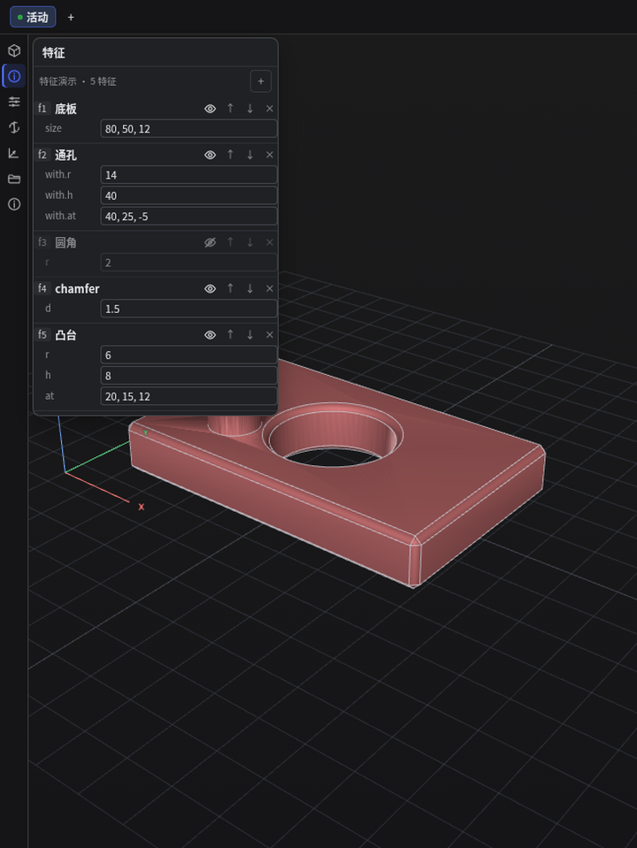

# dsh-cad-studio

DeepSeek Harness 的 CAD 插件：**把 FreeCAD 桥接成给 AI 用的工具**，并在 Web 右栏提供一个只读+轻交互的 3D 面板。



- Host 侧（`index.js`）：14 个工具 + `/cad-studio/*` HTTP 路由 + `freecadcmd` 子进程桥
- 客户端侧（`client.js`）：右栏页签「CAD 工作室」，three.js 视口 + 图标条浮层（零件 / 特征 / 选中项 / 运动 / 视图 / 模型 / 信息）
- 数据：`<modelsDir>/<名字>.json` 存模型工程（脚本或声明式特征 + 参数 + 20 条历史）；场景网格落 `$TMPDIR/dsh-cad-studio/{state.json,scenes/*.json}`

## 能力

| 领域 | 做什么 |
|---|---|
| 建模 | `cad_studio_feature` 声明式特征（box/cylinder/sphere/cone/torus/extrude/revolve/fuse/cut/common/fillet/chamfer/shell/pattern/translate/rotate/mirror）；`cad_studio_run` 跑任意 FreeCAD Python |
| 工程文件 | `cad_studio_doc` 存 `script` 或 `features` 两种模型；`cad_studio_features` 改一条特征→整表重算（0.2–0.6 s），失败整表回滚 |
| 装配 | `cad_studio_assembly` 读 manifest，`App::Link` 语义的实例位姿；零件是 STEP 文件级引用（改零件重开即跟随） |
| 运动 | `cad_studio_joint`（revolute/linear）+ `cad_studio_drive` + `cad_studio_explode`，面板拖滑杆看运动 |
| 出图 | `cad_studio_drawing` HLR → SVG（主/俯/左/等轴） |
| 其它 | `cad_studio_open`（STEP/STL/BREP/IGES 进来看）、`cad_studio_export`、`cad_studio_measure`、`cad_studio_env` |
| 模型清单 | `cad_studio_scene`（`action: list / delete / rename`）——面板里那条列表就是它；探查脚本留下的卡片可以直接删 |
| 特征 → STEP | `cad_studio_export {model:"名字", target:"…/x.step"}` 或 `cad_studio_doc {action:"show", name, export:"…/x.step"}`；特征列表是源，STEP 是产物，不用自己复刻发射器 |
| 旧 dsh-cad 文档 | `cad_studio_legacy`（`action: list / show`）只读列出 `/app/.dsh-cad` 的文档、op 数与体数 |
| 自检/安装 | `cad_studio_setup`：报告 freecadcmd 是否可用、版本、包管理器与可执行命令；`action=install` 直接装 |
| 面板 | 多页签（上限 5，各自记住相机与配色）、点选联动、色块换色、显隐、透明度、线框、隔离、标准视图、网格/轮廓/光影开关 |

## 安装

需要本机有 `freecadcmd`（FreeCAD ≥ 0.20）。装插件不等于装 FreeCAD——它是外部程序，213 MB 左右，不随 npm 包分发。

装法二选一：

1. **让面板装**：打开右栏「CAD 工作室」→ 信息（i）→ 看到黄框点「自动安装 FreeCAD」。后端 `cad_studio_setup` 会自动识别 apt / dnf / pacman / brew 并执行（apt 需要 root）。
2. **自己装**：`apt install freecad`，然后在插件配置里留空 `freecadPath`（自动探测 `/usr/bin/freecadcmd` 等 5 个位置）或显式指定。

```bash
# 从 npm 装（推荐）
dsh plugin --profile web add dsh-cad-studio

# 或从源码目录装
dsh plugin --profile web add /path/to/dsh-cad-studio
# 装完重启 dsh 使 host 侧工具挂载；client 侧刷新页面即可
```

npm 包：<https://www.npmjs.com/package/dsh-cad-studio>（`dsh plugin` / DSH 插件市场按包名解析，发布到 npm 即可被装到）。

配置项（cordis 配置）：

| 键 | 默认 | 说明 |
|---|---|---|
| `freecadPath` | `''`（自动探测 5 个位置） | `freecadcmd` 路径 |
| `timeoutMs` | `180000` | 单次脚本超时 |
| `modelsDir` | `''` | 模型工程目录；空 = 跟随调用会话工作区的 `cad-models/` |
| `autoOpen` | `'session'` | 面板何时自己占位右栏：`session` = 只有做 CAD 的会话（默认）、`always` = 每个会话、`off` = 从不（页签留在「+」菜单里） |
| `trustedHosts` | `[]` | 额外允许访问 `/cad-studio/*` 的主机名（本机回环默认允许） |

`autoOpen: 'session'` 的判据是宿主侧的两个信号：这个会话最近一次发布过场景（`lastSession`），或它拥有更早发布过的场景。也就是说——只有真正在这里建过模的对话，右栏才会自动让出位置；别的对话不受打扰。

## 两个容易踩的接口约定

- **导出只走 `cad_studio_export`**。在 `cad_studio_run` 里直接 `Part.export([compound], path)` 会写出一个 1.6 KB 的 STEP 壳子，读回来是空形状，而脚本本身不报错。要么用 `cad_studio_export`，要么给 `cad_studio_run` 传 `check: ["/path/out.step"]`——它会在跑完后把这个文件读回来，回报 `{bytes, solids, volume, valid}`，壳子会显示 `valid:false`。
- **探查脚本别发布场景**。`cad_studio_run` 默认会把绑定的 `scene` 发布成面板里的一行；只是量体积/查干涉的脚本传 `publish: false`，否则模型列表会被探针卡片塞满（实测一次会话攒到 28 行）。已经混进去的用 `cad_studio_scene {action:"delete", id:"scene-12"}` 清。
- `cad_studio_export` 的返回里 `volume` / `solids` 是**真正写出去的那一套**，`sourceVolume` / `sourceSolids` 是输入侧的；`minVolume` 会按实体体积过滤（滤掉圆丝、灰尘），`alsoStl` 顺手写一份 STL。
- `cad_studio_assembly` 传 `measure: true` 会回每实例的 bbox/体积/实体数与总体积，`interference: true` 会回真正重叠的实例对（先用包围盒筛，再做布尔交）。
- **`fuse` / `cut` / `common` 的 `with` 可以是数组**：U 形围壁写成「一条 `fuse` 外块 + 一条 `cut` 带两个内腔」即可，不必拆成中间状态（中间状态是实心块，顺序错了会削到别处）。
- **`extrude` 支持 3D 剖面点与 `dir`**：三角棱柱写 `{kind:"extrude", points:[[0,0,0],[40,0,0],[0,30,0]], dir:[0,0,20]}`，不用再拿 `base`/`h` 手算覆盖范围。
- 特征参数在 `normalizeFeature` 阶段就校验，报错带行号与名字：`特征 f10（倒角_左后） cut：需要 with 子图元（…）`——不会再从 FreeCAD 里冒出一句 `第 10 步（cut）失败：'with'`。
- 删掉的面板行不会被下一次发布「复活」：`persist()` 会跟磁盘对账，只保留磁盘上还有的、或本进程发布过的行。

## 场景 JSON 协议

```jsonc
{
  "parts": [{ "id": "p1", "verts": [...], "tris": [...], "volume": 1234.5 }],
  "instances": [{ "name": "底座", "part": "p1", "rot": [1,0,0, 0,1,0, 0,0,1], "translate": [0,0,0] }],
  "assembly": { "id": "asm-1", "title": "运动演示", "explode": 0,
                "joints": [{ "id": "hinge", "instance": "盖板", "type": "revolute",
                             "axis": [1,0,0], "origin": [0,0,40], "value": 0, "min": -90, "max": 90 }] }
}
```

`rot` 是行主序 3×3，`translate` 是 mm。几何按**逐面三角化**，平面与孔壁不共享顶点（避免法线平均出暗色扇形）。

## 开发

```bash
node test/harness.mjs      # 133 条回归：无浏览器，stub cordis ctx 直接调工具
node test/stale-bridge.mjs # 热重载后旧 bridge 实例自愈
```

`test/replicate.mjs`、`scripts/*.mjs` 是我自己造场景/验证用的夹具，按需改路径。

## 已知限制

- 依赖外部 `freecadcmd`（约 213 MB），不是纯 wasm
- 关节只支持 revolute / linear，没有约束求解器
- 没有草图参数化与约束求解
- 工具粒度比 dsh-cad 的 34 个增量工具粗：常见活走 `feature`，特殊活写脚本

## License

MIT
